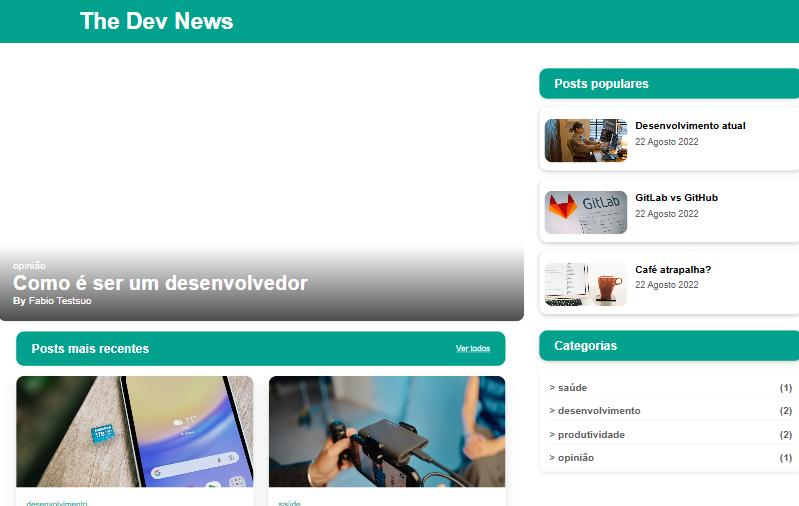

# 📰 Blog Responsivo — The Dev News

Página de blog **totalmente responsiva**, desenvolvida com **HTML e CSS** em um desafio prático da formação em desenvolvimento de software da Escola DNC.

🔗 **Ver online:** https://mgarajau.github.io/blog-responsivo/



## ✨ Destaques

- Estrutura **semântica** com HTML5 (header, main, aside, footer)
- Layout que se adapta a **celular, tablet e desktop** com **Media Queries**
- Post em destaque, lista de posts recentes, posts populares e categorias
- Publicado no **GitHub Pages**

## 🛠️ Tecnologias


## ▶️ Como rodar

Basta clonar o repositório e abrir o `index.html` no navegador:

```bash
git clone https://github.com/mgarajau/blog-responsivo.git
```

## 👤 Autor

**Matheus Garajau** · [LinkedIn](https://www.linkedin.com/in/matheus-garajau/) · [GitHub](https://github.com/mgarajau)
